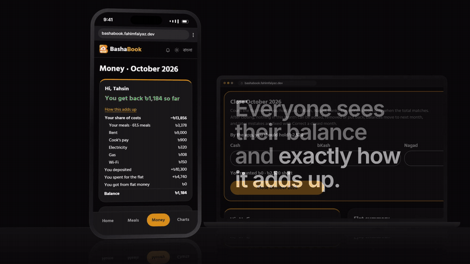
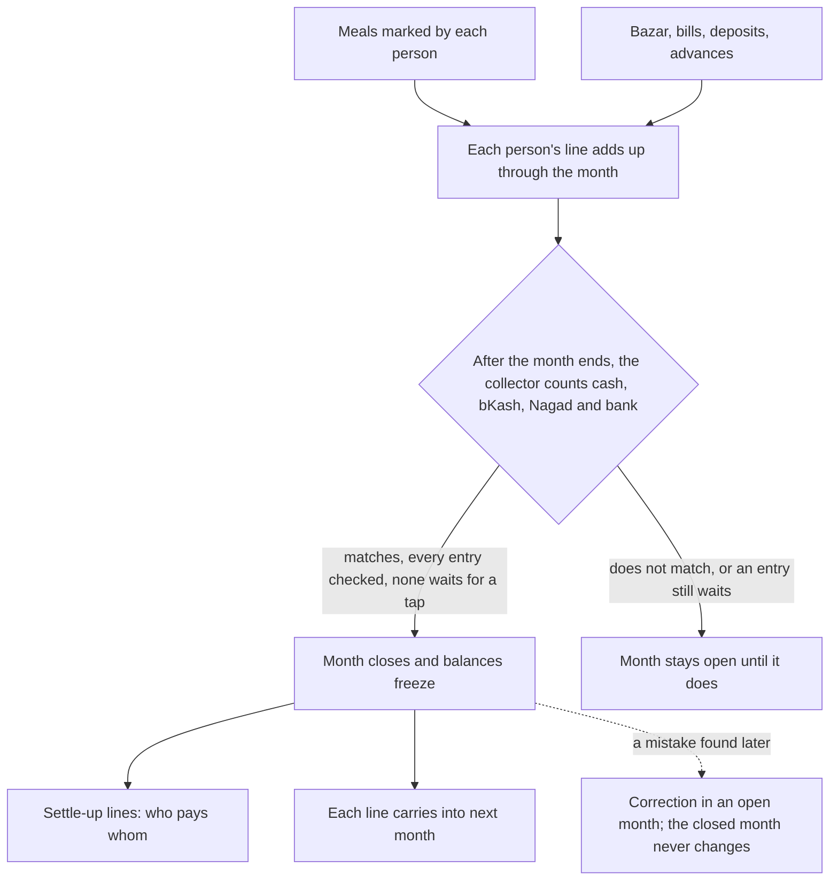
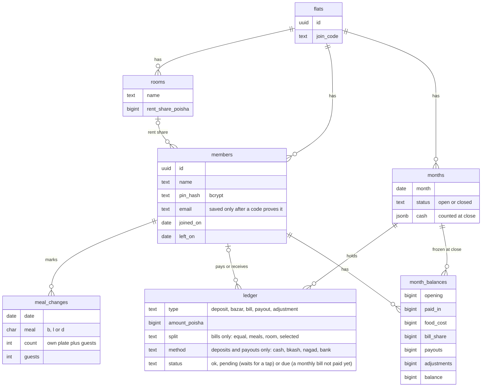
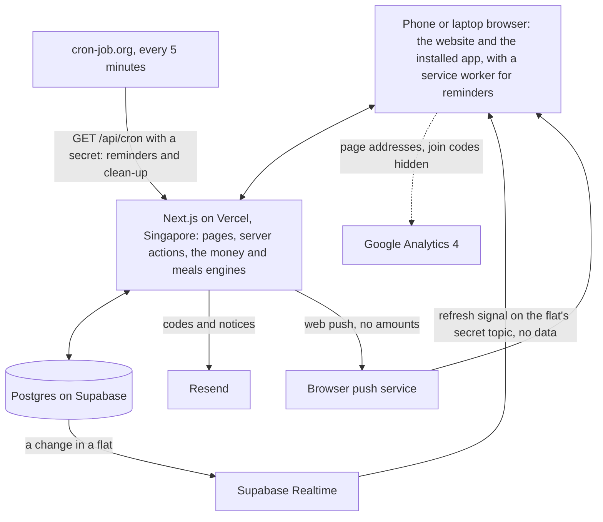

<p align="center">
  <picture>
    <source media="(prefers-color-scheme: dark)" srcset=".github/assets/logo-dark.png">
    
  </picture>
</p>

<p align="center">
  
  
  
  
  
  
  
</p>

<p align="center">
  <a href="https://bashabook.fahimfaiyaz.dev"></a>
</p>

Watch the full 60-second film, with sound:

https://github.com/user-attachments/assets/823c4a9c-1a36-43f2-86b0-076452d7e9e5

Shared-flat accounts for Bangladeshi flats of eight to ten people with a hired cook. Who ate how many plates, who paid for bazar and bills, what each person owes or gets back, and a month end that closes only when the cash in hand matches the books.

A website and an installable web app (PWA), designed for a 360 px phone and for a full laptop screen. English and Bangla, both first-class.

Live: https://bashabook.fahimfaiyaz.dev · Free to use.

## Who it is for

Every flat has one person who holds the money and keeps the khata. BashaBook is that khata, shared with everyone in the flat so nobody has to ask "why do I owe this?" at month end.

- **The collector** holds the flat's money, saves bazar and bills, confirms deposits, closes the month and hands over to the next collector when they move out.
- **Flatmates** mark their own meals and guests, deposit money, and watch their own line add up through the month.
- **The cook** gets today's and tomorrow's plate count as a message anyone can forward from their phone.

## What it does

**Getting in.** The collector creates the flat and adds everyone's names; each person opens the flat's link, picks their name, proves their email with an 8-digit code and chooses a 4-digit PIN (easy ones like 1234, 1111 or a year are refused). Forgot the flat code or the PIN? A code comes to that email. The phone remembers the last flat it opened, and the app can be installed from the browser.

**Home.** Today's and tomorrow's meals, today's plates for the cook, your line (owe or get back), money and checks waiting for your tap, and the bell with what changed for you. Pages update by themselves when someone else saves something.

**Meals.** Breakfast, lunch and dinner per person per day. Anyone can switch a meal on or off for today or any later day; a change for today notifies everyone with reminders on, with today's plates so the cook can be told. Guests count as extra plates on your line. No-cooking days, days away (from tomorrow on), moving in and out mid-month, and a history of every change. A month grid shows the whole month at once.

**Money.** One page for the month: Add bazar, Add bill (rent by room, equal, by meals, or for chosen people), I paid; Give money (an advance from the flat) on the Flat tab. Money paid in or given out can say how it moved: cash, bKash, Nagad or bank. Every entry shows who saved it and when; the receiver confirms any money between two people. A bazar can list what was bought and carry a receipt photo. The collector checks every bazar and bill (a flatmate checks the collector's own) and can send one back for a fix; an amount far above the usual is flagged. Monthly bills arrive as due until the collector marks them paid. Your balance breakdown shows how your line adds up, to the poisha. The collector can open anyone's breakdown and share it.

**Charts.** The month as a dashboard: a strip of numbers, the spend climbing through the month, where the money went, your meals and your month as a receipt that adds up, the last six months, and for the collector everyone's cost. A forecast of where the month ends at this pace, and, only when there is something to ask, questions about an entry saved twice, a bazar bigger than any before, or a usual bill that has not come.

**Flat.** For the collector: people and rooms, rent shares, meal weights, the join code, handover of the money and the role, and the close card.

**Month end.** The collector counts cash, bKash, Nagad and bank. The month closes only when the total matches what the app says the flat holds and every bazar and bill is checked (from the 4th it can close anyway, marked "closed without a check" for everyone to see). Flatmates are asked whether they saw the cash. Balances freeze, each person's line carries into next month, and the settle-up lines say who pays whom. Mistakes found later go in as corrections that never change a closed month's cash. The collector can download a closed month as a CSV: its entries, then each person's line.



**Reminders.** Web push, once you turn it on: when someone changes today's meals, when money or a handover needs your answer, when a bazar or bill waits for a check and when a month is ready to close. Today's meal notices can be muted on their own; a change someone makes to your own meal still reaches you. No amounts in a notification. Changes to your meals, money waiting for you and today's meal changes also show on the bell, for anyone who keeps push off.

## How the money is counted

- All amounts are integer poisha. Splits use largest-remainder allocation, so shares always add up to the total exactly.
- Food cost is the month's bazar split by weighted meals; the meal rate shown is bazar divided by meals, for display only.
- Each person's line is opening balance + paid in − food − bill share − advances + corrections. The sum of all lines always equals the flat's money; the app refuses to close a month where it does not.
- A closed month is a snapshot. Nothing recalculates it later.

The core tables (the full schema is in `db/migrations/`). Rows point at members, rooms and months through composite foreign keys (the flat's id plus the row's key), so the database refuses a link to another flat's person, room or month; the few links it cannot express are checked by the app.



## Privacy

A flatmate sees the flat's entries and everyone's balance, and only their own line-by-line breakdown (the collector can open anyone's). Each person's email is used only to send codes (to prove the address, or when the flat code or PIN is forgotten) and to say when their PIN or email changed; flatmates never see it. Codes are stored only as hashes. Nothing is sent to any AI service. The live site counts visits with Google Analytics 4, which sets its own cookie and collects what its tag always does (device, browser, rough location from the IP, time on page). The app tells it page addresses with a join link's flat code hidden and no query strings, and never names, phone numbers, amounts or anything typed in. Setup: `ops/analytics.md`. The full policy is on the site's [privacy page](https://bashabook.fahimfaiyaz.dev/en/privacy). The app is free and says so; there is no plan behind it.

Limits: a flat holds up to 30 names, counting people who moved out. Creating flats, join-code lookups, PIN tries and email codes are rate-limited per IP address, and those counts are deleted after about two hours. Email codes also have a daily cap per connection, kept for two days as a keyed hash that can't be turned back into the address. Email goes through Resend's free plan (100 a day), split into day budgets for codes and notices; when a budget runs out the screen says so. A trial flat nobody used (no entries, no meal changes, at most one person set a PIN, nothing in its history for a month) is deleted once it is a month old.

## Stack

Next.js 16 (App Router, server components and actions), React 19, TypeScript, Tailwind CSS 4, Postgres on Supabase through postgres.js with plain SQL migrations, bcryptjs for PINs, web-push for reminders. Live page updates listen to Supabase Realtime over a plain WebSocket, and email goes to Resend's HTTP API; neither needs an SDK. Charts are hand-drawn SVG; there is no chart or UI library. Six runtime dependencies.



Tests: Vitest with PGlite (Postgres in process) for the schema and money engine, a WCAG contrast test, and Playwright drives for the pages. CI on every PR: typegen, tsc, eslint, vitest. Deployed on Vercel (Singapore), previews per PR.

## Run it

```
npm install
npm run migrate     # applies db/migrations to the database in .env.local (DATABASE_URL)
npm run dev
npm test
npm run build
```

Environment: `DATABASE_URL`; for reminders `VAPID_PUBLIC_KEY`, `NEXT_PUBLIC_VAPID_PUBLIC_KEY`, `VAPID_PRIVATE_KEY`, `VAPID_SUBJECT`, `CRON_SECRET` (see `ops/reminders.md`); for email `RESEND_API_KEY` (locally, without a key, `EMAIL_LOG=1` prints the mail instead; never set it on Vercel); for live updates `NEXT_PUBLIC_SUPABASE_URL` and `NEXT_PUBLIC_SUPABASE_ANON_KEY`; for analytics `NEXT_PUBLIC_GA_ID`, production only (see `ops/analytics.md`). A cron job calls `GET /api/cron` every five minutes with the secret.

## Layout of the repo

- `app/[lang]/` pages and server actions, one dictionary for both languages in `dictionaries.ts`
- `lib/` the money and meals engines (pure, tested), database access, auth, close, handover, notifications
- `db/migrations/` numbered SQL, applied in order
- `scripts/` operations scripts (delete a flat, reset a collector's PIN, race tests against a test copy)
- `ops/` operations notes: reminders, PIN recovery, data retention, analytics, and the welcome note for a new flat's group chat

## Status

Live since October 2026; the first real flat starts in November 2026. Not now, by decision: an AI assistant, live sync with spreadsheets, a personal spending diary. Features come from what flats ask for.
