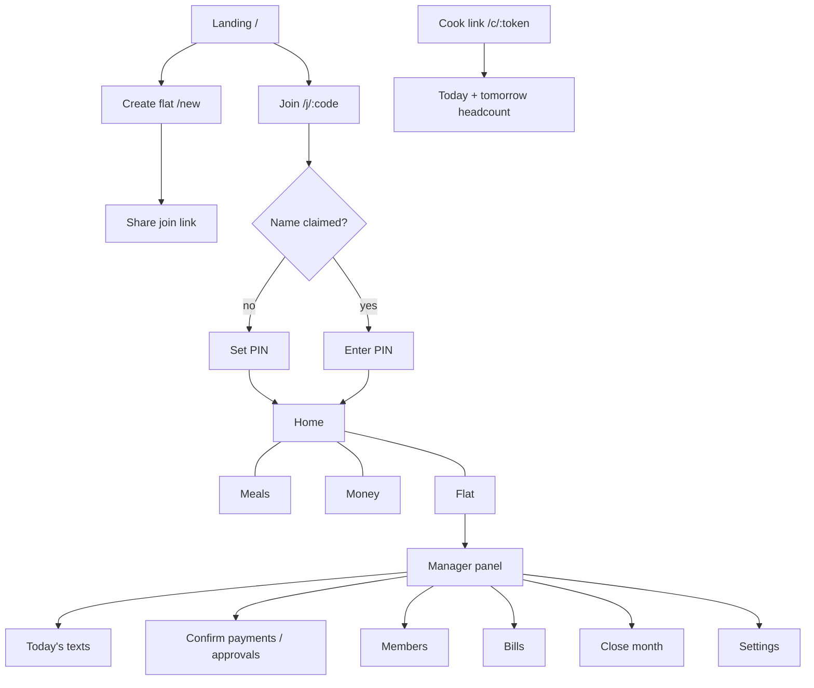
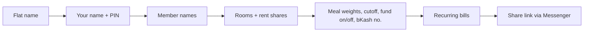
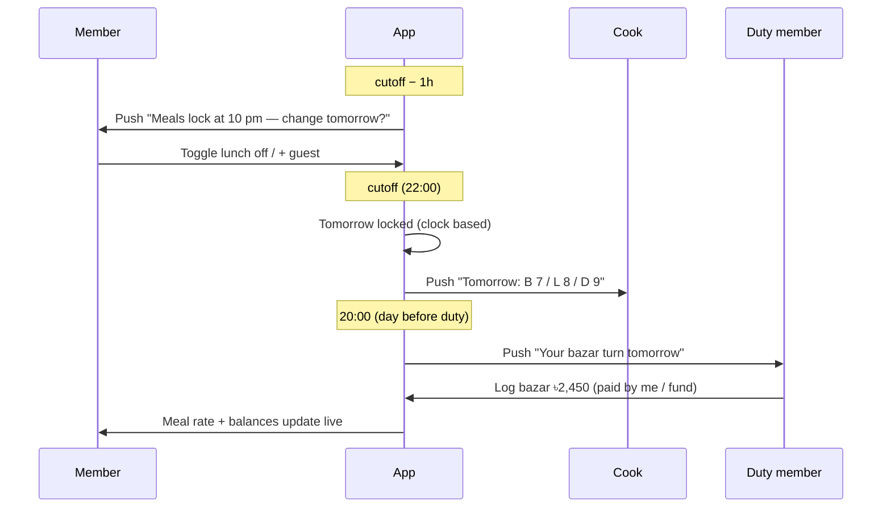
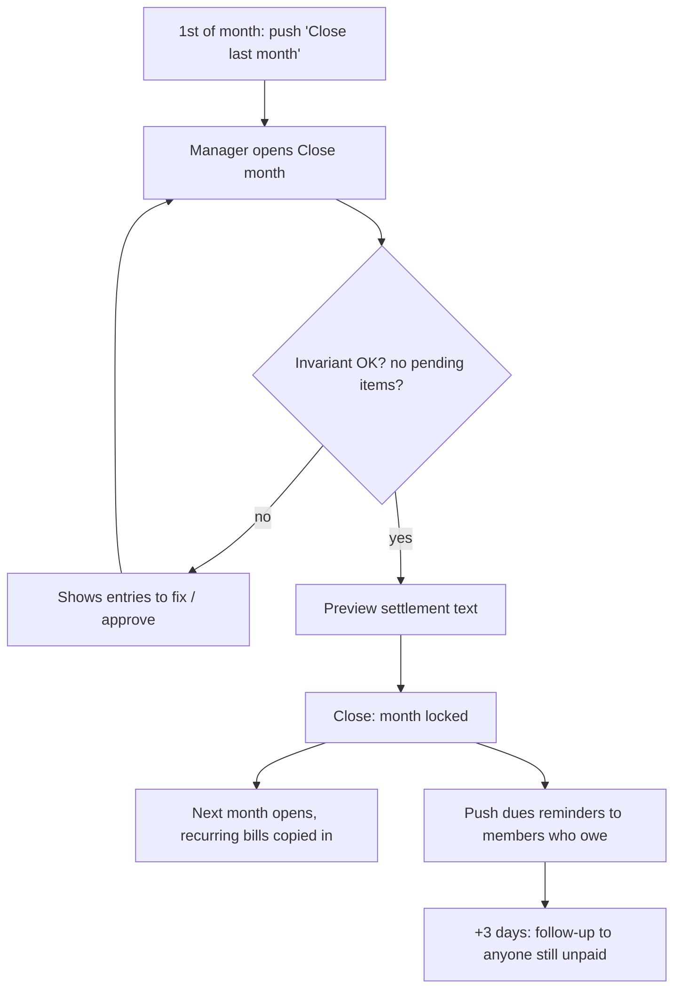

# Mil: App Flow (V1)

## 1. Site map

## 2. Create a flat (manager, ~3 min)

Every step after B can be skipped and finished later in Settings.

## 3. Join (member, ~20 s)

Tap the link in Messenger → see the names → tap mine → set a 4-digit PIN → Home, showing "Turn on reminders" and, on iPhone, the "Add to Home Screen" guide.

## 4. A normal day

## 5. Paying dues

Member → Money → Pay dues → sees the manager's bKash number and the amount owed → pays in the bKash app → enters the TrxID and amount → **pending** → manager confirms in the panel → balance updates. A duplicate TrxID is rejected.

## 6. Month close

## 7. Move-out

Manager → Members → Move out → pick the date → if this member is the manager, hand over the role first → the app shows their prorated final balance → the manager records a payout or deposit to settle it → the member stays visible in history and drops out of headcounts after the move-out date.

## 8. Strict mode differences

Any action marked "change request" in TRD §6 shows the member a "Sent to manager for approval" banner and goes into the manager's Approvals list. Nothing changes the numbers until it's approved.

## 9. Empty and error states

| Situation | What the user sees |
|---|---|
| No bazar yet this month | Meal rate shows "—" with "Add the first bazar" |
| Invariant fails | Red banner on Close month listing the entries involved |
| Session expired | PIN screen; returns to the same page afterwards |
| PIN locked | "Try again in N min or ask your manager" |
| Edit conflict | "Someone else changed this. Reload" |
| Push blocked | Reminders card explains how to allow notifications |
